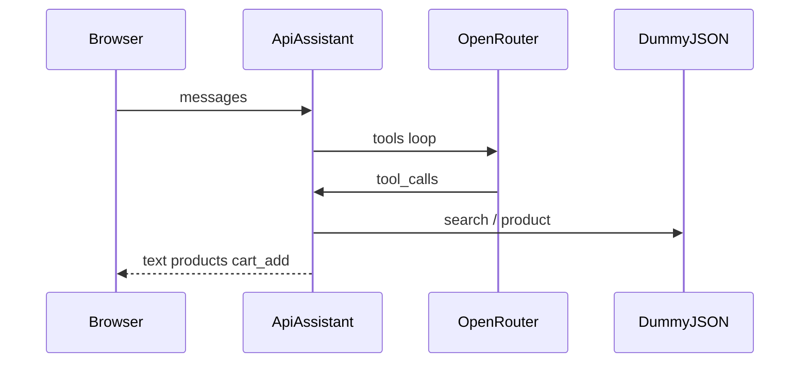

# Atelier

Витрина на **Nuxt 4** с плавающим ИИ-консультантом: каталог, карточка товара, корзина и оформление заказа. Товары приходят из [DummyJSON](https://dummyjson.com/) через Nitro BFF. Вживую: [https://nuxt4-headless-ecommerce.vercel.app/](https://nuxt4-headless-ecommerce.vercel.app/).

Автор: [Pavel Mazan](https://github.com/mazan-pavel) · лицензия [MIT](LICENSE)

## Стек

- Nuxt 4, Vue 3, TypeScript
- Tailwind CSS и shadcn-vue
- Pinia и VueUse
- `@nuxt/image`, `@nuxt/fonts`
- Консультант: OpenRouter (`openai` SDK), zod, Upstash Ratelimit

Каталог, поиск и карточка товара ходят в `server/api`. Контракт DummyJSON описан в [`docs/dummyjson-api.md`](docs/dummyjson-api.md). Архитектура чата — в [`docs/ai-assistant.md`](docs/ai-assistant.md).

## Быстрый старт

Нужен **Node.js 22+**.

```bash
npm install
cp .env.example .env
npm run dev
```

Сервер разработки: [http://localhost:3000](http://localhost:3000)

```bash
npm run build
npm run preview
```

Локальный аудит Lighthouse (сервер должен быть запущен):

```bash
npm run audit
```

SEO / AI crawlers: `/robots.txt`, `/sitemap.xml`, `/llms.txt`. Публичный origin задаётся через `NUXT_PUBLIC_SITE_URL` (см. `.env.example`).

## ИИ-консультант

Плавающая кнопка справа внизу открывает чат:

- поиск и рекомендации по каталогу;
- наличие, доставка, возврат и гарантия по данным товара;
- добавление в корзину только после явной просьбы.

Стек: браузер → `POST /api/assistant` (NDJSON) → OpenRouter с tool calling → DummyJSON → события обратно в UI и Pinia.



### Запуск с ключом

1. В `.env` задайте `OPENROUTER_API_KEY` и `OPENROUTER_MODEL` (оба обязательны).
2. Локально лимит — in-memory. На Vercel добавьте `UPSTASH_REDIS_REST_URL` и `UPSTASH_REDIS_REST_TOKEN`, иначе консультант ответит 503.
3. Опционально: `ASSISTANT_IP_LIMIT`, `ASSISTANT_IP_WINDOW_MIN`, `ASSISTANT_DAILY_LIMIT` (дефолты 10 / 10 мин / 20 в сутки).

Подробности и схема инструментов: [`docs/ai-assistant.md`](docs/ai-assistant.md). Сценарии: [`docs/assistant-scenarios.md`](docs/assistant-scenarios.md).

```bash
# сервер уже запущен
npm run eval:assistant
```

### Ограничения демо

- Ассортимент DummyJSON на английском; ответы — на языке пользователя.
- Один вопрос ≈ 2–3 запроса к модели; бесплатный OpenRouter ≈ 50 запросов/сутки.
- Нет оплаты и реальной службы доставки — только поля товара из API.
- Качество зависит от модели OpenRouter.

## Скриншоты

| кадр | файл |
|------|------|
| Кнопка на каталоге | [TODO: `docs/screenshots/01-launcher.png`](docs/screenshots/01-launcher.png) |
| Пустой чат | [TODO: `docs/screenshots/02-empty-suggestions.png`](docs/screenshots/02-empty-suggestions.png) |
| Подарок до $30 | [TODO: `docs/screenshots/03-gift-cards.png`](docs/screenshots/03-gift-cards.png) |
| Доставка и возврат | [TODO: `docs/screenshots/04-shipping-return.png`](docs/screenshots/04-shipping-return.png) |
| Добавление в корзину | [TODO: `docs/screenshots/05-cart-add.png`](docs/screenshots/05-cart-add.png) |
| Мобильная панель | [TODO: `docs/screenshots/06-mobile.png`](docs/screenshots/06-mobile.png) |
| Тёмная тема | [TODO: `docs/screenshots/07-dark.png`](docs/screenshots/07-dark.png) |

Список кадров и имена файлов: [`docs/screenshots/README.md`](docs/screenshots/README.md).

## Лицензия

MIT © Pavel Mazan ([mazan-pavel](https://github.com/mazan-pavel))
