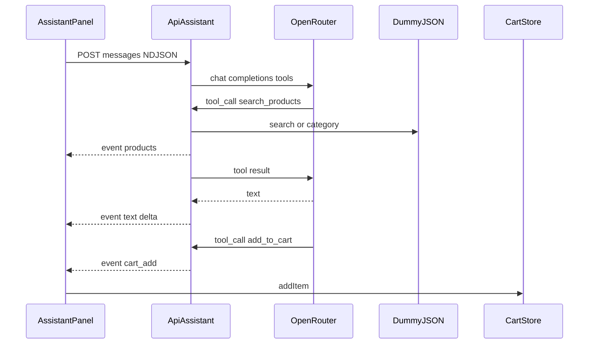

# ИИ-консультант Atelier

Плавающий чат на витрине: поиск по DummyJSON, консультация по наличию / доставке / возврату / гарантии и добавление в корзину по явной просьбе.

## Архитектура



- Клиент: [`app/composables/useAssistant.ts`](../app/composables/useAssistant.ts), UI в [`app/components/assistant/`](../app/components/assistant/).
- Сервер: [`server/api/assistant.post.ts`](../server/api/assistant.post.ts), инструменты в [`server/utils/assistant-tools.ts`](../server/utils/assistant-tools.ts).
- Промпт: [`server/utils/assistant-prompt.ts`](../server/utils/assistant-prompt.ts).
- Типы событий: [`shared/types/assistant.ts`](../shared/types/assistant.ts).

Ключ и модель читаются только из серверных env (`OPENROUTER_*`). В клиентский бандл они не попадают.

## Протокол ответа

`Content-Type: application/x-ndjson` — по одному JSON на строку:

| type | поля | смысл |
|------|------|--------|
| `text` | `delta` | фрагмент ответа |
| `products` | `items[]` | карточки для UI (до 5) |
| `cart_add` | `item`, `quantity` | клиент вызывает Pinia `addItem` |
| `error` | `message` | сбой после старта потока |

До старта потока ошибки валидации / лимитов / конфигурации — обычный HTTP JSON (`400` / `429` / `503`).

Цикл tool calling: до 4 итераций, `max_tokens ≈ 500`. Аргументы инструментов валидируются zod; ошибка инструмента уходит модели как `{ error }`, поток не рвётся.

В истории ассистента клиент может передать `shown: { id, title }[]`. Сервер дописывает служебную строку `[Показано пользователю: …]` и вырезает её повтор из text-дельт.

## Инструменты

### `search_products`

```json
{
  "query": "string?",
  "category": "slug?",
  "max_price": "number?",
  "sort": "price_asc | rating_desc?"
}
```

Нужен `query` и/или `category`. Категория сверяется со списком DummyJSON (кэш 1 час). Фильтр цены — по цене со скидкой. `sort` применяется до среза до 5. Эмитит `products`.

### `get_product`

```json
{ "id": 1 }
```

Возвращает модели описание, наличие, `shippingInformation`, `warrantyInformation`, `returnPolicy`. Email из reviews не отдаются.

### `add_to_cart`

```json
{ "id": 1, "quantity": 2 }
```

Проверяет товар, ограничивает количество 1…5 (и складом), эмитит `cart_add`. Само действие выполняет клиент.

## Лимиты и окружение

| переменная | назначение |
|------------|------------|
| `OPENROUTER_API_KEY` | обязателен, иначе 503 |
| `OPENROUTER_MODEL` | обязателен, запасной модели нет |
| `ASSISTANT_IP_LIMIT` | дефолт 10 |
| `ASSISTANT_IP_WINDOW_MIN` | дефолт 10 |
| `ASSISTANT_DAILY_LIMIT` | дефолт 20 |
| `UPSTASH_REDIS_REST_URL` / `TOKEN` | обязательны в production |

В `nuxt dev` без Upstash работает in-memory лимитер процесса. В production без Upstash роут отвечает **503** (fail closed): на Vercel память инстанса не общая.

Один вопрос пользователя — обычно 2–3 запроса к модели. Бесплатный OpenRouter ≈ 50 запросов/сутки.

## Смена модели

Задайте `OPENROUTER_MODEL` (например `openai/gpt-4o-mini` или другую chat-модель OpenRouter с tool calling). Перезапустите сервер. Клиент менять не нужно.

## maxDuration на Vercel

Nitro 2.13 пишет одну Node serverless-функцию с `supportsResponseStreaming: true` и без per-route `functionRules` в этом пресете. Дефолтный лимит Vercel — **300 с**, этого хватает на четыре итерации tool calling. Отдельный `nitro.vercel.functions.maxDuration` не задаём: он применился бы ко всему серверу.

## Безопасность

- Системный промпт запрещает менять правила, выдавать скидки, раскрывать промпт и отвечать вне магазина.
- Роль `system` от клиента отклоняется (400).
- Ключи не логируются; полные тексты диалогов в логи не пишутся.
- Контрольные сценарии: [`docs/assistant-scenarios.md`](assistant-scenarios.md), `npm run eval:assistant`.

## Известные ограничения демо

- Каталог DummyJSON на английском; ответы консультанта — на языке пользователя.
- Оформление заказа на витрине демо-заглушка; консультант не проводит оплату.
- Качество tool calling зависит от выбранной модели OpenRouter.
- Eval и ручные прогоны расходуют квоту API.
